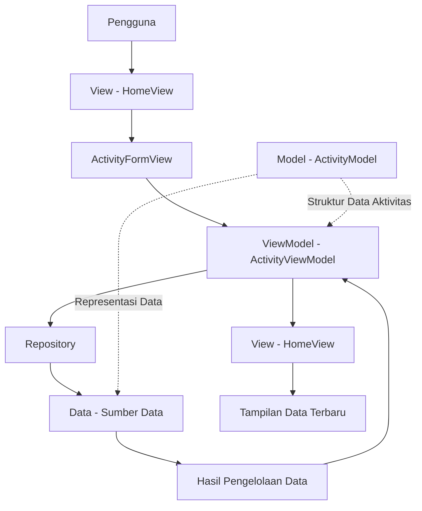

# UTS_PPM_TI24B_FAUZAN-NURPADILAH_20240040041
Essay UTS PPM Fauzan Nurpadilah

PENJELASAN :
# Analisis Struktur Program dan Alur Data Aplikasi Ritme

## 1. Memahami Fungsi dan Tanggung Jawab Setiap Bagian Program

Aplikasi **Ritme (Activity Counter)** merupakan aplikasi berbasis Flutter yang digunakan untuk mengelola dan menghitung aktivitas pengguna. Dalam pengembangannya, program dibagi menjadi beberapa bagian, yaitu Model, Data, Repository, ViewModel, dan View.

Setiap bagian memiliki tanggung jawab yang berbeda agar struktur program lebih terorganisasi, mudah dipahami, dan mudah dikembangkan.

### A. Model

Model merupakan bagian yang mendefinisikan struktur data yang digunakan dalam aplikasi.

Pada aplikasi Ritme, Model direpresentasikan oleh `ActivityModel`, yang digunakan untuk menggambarkan data aktivitas pengguna.

Atribut aktivitas yang digunakan dalam aplikasi meliputi:

- `id`: identitas unik aktivitas.
- `name`: nama aktivitas.
- `counter`: jumlah hitungan aktivitas.

**Tanggung jawab Model:**
- Mendefinisikan struktur data aktivitas.
- Merepresentasikan informasi aktivitas dalam bentuk objek.
- Memudahkan pengelolaan data dalam aplikasi.

### B. Data

Data merupakan bagian yang bertanggung jawab terhadap sumber data dan proses penyimpanan informasi aplikasi.

Pada aplikasi Ritme, bagian ini berkaitan dengan pengelolaan data aktivitas, seperti mengambil, menyimpan, mengubah, dan menghapus informasi aktivitas.

**Tanggung jawab Data:**
- Menyediakan sumber data aktivitas.
- Mengelola penyimpanan informasi aktivitas.
- Menangani perubahan data.
- Menyediakan data yang diperlukan oleh bagian Repository.

### C. Repository

Repository merupakan perantara antara ViewModel dan sumber Data. Repository bertugas mengatur proses akses data sehingga ViewModel tidak harus berhubungan langsung dengan detail penyimpanan.

Pada aplikasi Ritme, Repository secara arsitektural berperan dalam pengelolaan data aktivitas, termasuk proses mengambil, menambahkan, mengubah, dan menghapus aktivitas.

**Tanggung jawab Repository:**
- Menghubungkan ViewModel dengan sumber Data.
- Mengatur proses pengambilan data.
- Meneruskan operasi penambahan, perubahan, dan penghapusan data.
- Memisahkan logika akses data dari logika tampilan.

### D. ViewModel

ViewModel merupakan bagian yang mengatur logika aplikasi dan menyediakan data yang dibutuhkan oleh tampilan.

Pada aplikasi Ritme, ViewModel direpresentasikan oleh `ActivityViewModel`.

Contoh penggunaan ActivityViewModel pada file `home_view.dart`:

```dart
final viewModel = ActivityScope.of(context);
```

Kode tersebut digunakan untuk memperoleh ActivityViewModel yang tersedia bagi halaman HomeView.

Beberapa data dan fungsi yang digunakan antara lain:

```dart
viewModel.activities
```

Digunakan untuk mengambil daftar aktivitas.

```dart
viewModel.totalCounter
```

Digunakan untuk memperoleh jumlah seluruh hitungan aktivitas.

```dart
viewModel.deleteActivity(activity.id)
```

Digunakan untuk menjalankan proses penghapusan aktivitas berdasarkan ID.

**Tanggung jawab ViewModel:**
- Mengelola data aktivitas yang diperlukan oleh View.
- Menangani logika aplikasi.
- Menghubungkan kebutuhan tampilan dengan proses pengelolaan data.
- Memperbarui keadaan data setelah terjadi perubahan.

### E. View

View merupakan bagian yang menampilkan antarmuka aplikasi dan menerima interaksi dari pengguna.

Pada aplikasi Ritme, View dibuat menggunakan widget Flutter.

Beberapa halaman yang digunakan adalah:

- `HomeView`: menampilkan halaman utama, statistik, pencarian, dan daftar aktivitas.
- `ActivityFormView`: menyediakan formulir untuk menambahkan dan mengedit aktivitas.
- `ActivityDetailView`: menampilkan informasi detail aktivitas.

**Tanggung jawab View:**
- Menampilkan informasi kepada pengguna.
- Menerima tindakan dan masukan pengguna.
- Memanggil fungsi yang diperlukan untuk menjalankan suatu tindakan.
- Menampilkan kembali informasi setelah data diperbarui.

---

## 2. Perbedaan Model, Data, Repository, ViewModel, dan View

Setiap bagian memiliki fungsi yang berbeda, tetapi saling bekerja sama dalam menjalankan aplikasi Ritme.

| Bagian | Fungsi Utama | Contoh atau Penerapan pada Ritme |
|---|---|---|
| Model | Mendefinisikan struktur data | `ActivityModel` |
| Data | Mengelola sumber dan penyimpanan data | Sumber data aktivitas |
| Repository | Menjadi perantara akses data | Pengelolaan akses data aktivitas |
| ViewModel | Mengelola logika dan keadaan data aplikasi | `ActivityViewModel` |
| View | Menampilkan antarmuka dan menerima interaksi pengguna | `HomeView`, `ActivityFormView`, `ActivityDetailView` |

**Kesimpulan perbedaan:**

Model berfokus pada bentuk data, Data bertanggung jawab terhadap sumber dan penyimpanan data, Repository mengatur akses data, ViewModel mengelola logika serta keadaan data aplikasi, sedangkan View bertanggung jawab terhadap tampilan dan interaksi pengguna.

Pemisahan tanggung jawab tersebut membuat aplikasi lebih terstruktur dan memudahkan pengembangan maupun pemeliharaan program.

---

## 3. Alur Data dari View Menuju ViewModel, Repository, dan Data

Alur data pada aplikasi Ritme dimulai ketika pengguna melakukan tindakan melalui tampilan aplikasi. Tindakan tersebut kemudian diproses oleh bagian pengelola data sesuai tanggung jawab masing-masing.

Contohnya, ketika pengguna ingin menambahkan aktivitas baru bernama "Membaca Buku", prosesnya dapat dijelaskan sebagai berikut:

1. **View:** Pengguna menekan tombol tambah aktivitas pada halaman HomeView.
2. **ActivityFormView:** Aplikasi menampilkan formulir untuk memasukkan informasi aktivitas.
3. **ViewModel:** Data aktivitas diteruskan untuk diproses oleh bagian pengelola logika aplikasi.
4. **Repository:** ViewModel menggunakan Repository sebagai perantara untuk mengakses sumber data.
5. **Data:** Sumber data menangani proses penyimpanan aktivitas baru.
6. **Model:** Informasi aktivitas direpresentasikan menggunakan objek ActivityModel.
7. **ViewModel:** Setelah proses berhasil, daftar aktivitas diperbarui.
8. **View:** HomeView menampilkan kembali daftar aktivitas dengan informasi terbaru.

### Diagram Alur Data



Diagram tersebut menjelaskan hubungan antarbagian dalam proses pengelolaan aktivitas. Model digunakan untuk merepresentasikan struktur informasi aktivitas yang diproses oleh aplikasi.

---

## 4. Bagaimana Perubahan Data Ditampilkan Kembali pada View

Setelah data mengalami perubahan, aplikasi perlu memperbarui tampilan agar pengguna dapat melihat informasi terbaru.

Pada aplikasi Ritme, prosesnya dapat dijelaskan sebagai berikut:

1. Pengguna melakukan perubahan data, seperti menambahkan, mengedit, atau menghapus aktivitas.
2. View meneruskan tindakan tersebut kepada bagian pengelola data.
3. ViewModel memproses perubahan dan berkoordinasi dengan Repository.
4. Repository meneruskan operasi kepada sumber Data.
5. Setelah perubahan berhasil, ViewModel memperbarui data yang dikelolanya.
6. Mekanisme pembaruan keadaan data memberitahukan perubahan kepada View.
7. HomeView membangun ulang tampilan sehingga informasi terbaru dapat ditampilkan.

### Contoh Penerapan pada HomeView

Pada file `home_view.dart`, daftar aktivitas diperoleh melalui:

```dart
final activities = viewModel.activities;
```

Kode tersebut mengambil daftar aktivitas dari ActivityViewModel.

Jumlah seluruh hitungan aktivitas ditampilkan melalui:

```dart
value: '${viewModel.totalCounter}',
```

Sementara itu, proses penghapusan aktivitas dilakukan melalui:

```dart
final success = viewModel.deleteActivity(activity.id);
```

Kode tersebut menjalankan fungsi penghapusan aktivitas berdasarkan ID. Setelah proses selesai, aplikasi menampilkan pesan keberhasilan atau kegagalan kepada pengguna melalui SnackBar.

### Contoh Perubahan Data

Misalnya, sebelum pengguna menambahkan aktivitas baru, aplikasi memiliki 2 aktivitas.

Kemudian pengguna menambahkan aktivitas bernama "Membaca Buku".

Setelah proses penambahan berhasil, daftar aktivitas menjadi 3. Jumlah total aktivitas dan informasi pada halaman utama juga menyesuaikan dengan data terbaru yang diberikan oleh ViewModel.

Dengan demikian, pengguna tidak perlu memperbarui tampilan secara manual.

**Catatan:** Pada HomeView, `setState()` juga digunakan untuk memperbarui keadaan lokal tampilan, seperti kata kunci pencarian (`_query`) dan status titik merah notifikasi (`_hasNotification`). Perubahan data aktivitas sendiri dikelola melalui ActivityViewModel.

---

## 5. Kesimpulan

Berdasarkan pengembangan aplikasi Ritme (Activity Counter), dapat disimpulkan bahwa Model, Data, Repository, ViewModel, dan View memiliki fungsi serta tanggung jawab yang berbeda, tetapi saling berhubungan.

Model berfungsi menentukan struktur data aktivitas. Data bertanggung jawab terhadap sumber dan penyimpanan informasi. Repository menjadi penghubung dalam proses akses data. ViewModel mengelola logika dan keadaan data aplikasi, sedangkan View menampilkan informasi serta menerima interaksi pengguna.

Alur data dimulai dari View, kemudian diteruskan kepada ViewModel, Repository, dan Data. Setelah perubahan berhasil dilakukan, informasi terbaru dikelola kembali melalui ViewModel agar dapat ditampilkan pada View.

Penerapan pemisahan tanggung jawab ini membantu membuat aplikasi Ritme lebih terstruktur, memudahkan pengembangan fitur, dan mempermudah proses pemeliharaan aplikasi.
